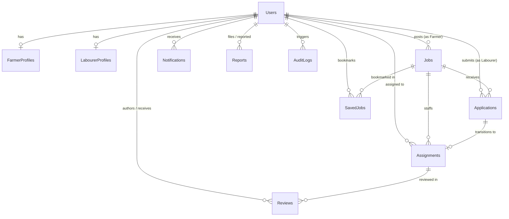

# AgriSetu Database Architecture Documentation

## 1. Database Overview
- **Database Name**: `AgriSetuDB`
- **RDBMS**: Microsoft SQL Server 2022 / 2025 Express
- **Collation**: `SQL_Latin1_General_CP1_CI_AS` (with `NVARCHAR` for Telugu and Hindi Unicode support)
- **Monetary Precision**: `DECIMAL(10, 2)`

---

## 2. Entity Relationship Diagram (ERD)

---

## 3. Table Specifications

### 3.1 `Users`
Stores primary account records for Farmers, Labourers, and Administrators.
- `id` (BIGINT, Primary Key, Identity)
- `full_name` (NVARCHAR(100), NOT NULL)
- `email` (NVARCHAR(150), NOT NULL, UNIQUE)
- `phone_number` (NVARCHAR(20), NOT NULL, UNIQUE) — Protected by privacy logic
- `password_hash` (NVARCHAR(255), NOT NULL) — BCrypt hashed
- `role` (NVARCHAR(20), CHECK IN ('FARMER', 'LABOURER', 'ADMIN'))
- `preferred_language` (NVARCHAR(10), CHECK IN ('en', 'te', 'hi'), DEFAULT 'en')
- `village`, `district`, `state` (NVARCHAR(100), NOT NULL)
- `privacy_consent` (BIT, DEFAULT 1)
- `share_contact_on_accept` (BIT, DEFAULT 1)
- `is_active` (BIT, DEFAULT 1)
- `created_at`, `updated_at` (DATETIME2(0))

### 3.2 `Jobs`
Stores agricultural job openings posted by farmers.
- `id` (BIGINT, Primary Key, Identity)
- `farmer_id` (BIGINT, FK -> Users.id)
- `title` (NVARCHAR(200), NOT NULL)
- `category` (NVARCHAR(100), CHECK IN ('Harvesting', 'Sowing', 'Ploughing', 'Weeding', 'Irrigation', 'Planting', 'Fertilizer Application', 'Fruit Picking', 'General Agricultural Labour'))
- `description` (NVARCHAR(MAX), NOT NULL)
- `farm_location`, `village`, `district`, `state` (NVARCHAR)
- `start_date`, `end_date` (DATE, CHECK end_date >= start_date)
- `working_hours` (NVARCHAR(50))
- `wage_amount` (DECIMAL(10,2))
- `wage_basis` (NVARCHAR(20), CHECK IN ('DAILY', 'HOURLY'))
- `required_workers` (INT, CHECK > 0)
- `confirmed_workers` (INT, DEFAULT 0, CHECK confirmed_workers <= required_workers)
- `remaining_vacancies` (INT, CHECK remaining_vacancies >= 0)
- `meals_provided`, `accommodation_provided`, `transportation_provided` (BIT)
- `safety_instructions` (NVARCHAR(500))
- `application_deadline` (DATE)
- `status` (NVARCHAR(30), CHECK IN ('DRAFT', 'PUBLISHED', 'PAUSED', 'CLOSED', 'CANCELLED', 'COMPLETED'))
- `version` (BIGINT, Optimistic Locking Version)

### 3.3 `Applications`
Tracks worker applications for open jobs.
- `id` (BIGINT, Primary Key, Identity)
- `job_id` (BIGINT, FK -> Jobs.id)
- `labourer_id` (BIGINT, FK -> Users.id)
- `status` (NVARCHAR(30), CHECK IN ('PENDING', 'ACCEPTED', 'REJECTED', 'WITHDRAWN'))
- `cover_note` (NVARCHAR(500))
- `applied_at`, `decided_at` (DATETIME2)
- `decision_reason` (NVARCHAR(300))
- **Constraint**: `UQ_Application_Job_Labourer UNIQUE (job_id, labourer_id)` — Prevents duplicate applications.

### 3.4 `Assignments`
Confirmed work contracts between a farmer and labourer.
- `id` (BIGINT, Primary Key, Identity)
- `job_id` (BIGINT, FK -> Jobs.id)
- `labourer_id` (BIGINT, FK -> Users.id)
- `application_id` (BIGINT, FK -> Applications.id)
- `status` (NVARCHAR(30), CHECK IN ('CONFIRMED', 'IN_PROGRESS', 'COMPLETED', 'CANCELLED'))
- `agreed_wage` (DECIMAL(10,2))
- `wage_basis` (NVARCHAR(20))
- `labourer_confirmed_completion` (BIT)
- `farmer_confirmed_completion` (BIT)
- `cancellation_reason` (NVARCHAR(300))

### 3.5 `Reviews`
Post-completion ratings (1 to 5) and feedback.
- `id` (BIGINT, Primary Key, Identity)
- `assignment_id` (BIGINT, FK -> Assignments.id)
- `reviewer_id` (BIGINT, FK -> Users.id)
- `target_user_id` (BIGINT, FK -> Users.id)
- `rating` (INT, CHECK rating BETWEEN 1 AND 5)
- `comment` (NVARCHAR(1000))
- **Constraint**: `UQ_Review_Assignment_Reviewer UNIQUE (assignment_id, reviewer_id)` — Prevents duplicate reviews.

---

## 4. Worker Allocation & Concurrency Guarantees

AgriSetu enforces the mathematical worker allocation rule:
$$\text{Remaining Vacancies} = \text{Required Workers} - \text{Confirmed Workers}$$

Concurrency protection is achieved at multiple layers:
1. **Pessimistic Row Lock (`SELECT ... FOR UPDATE`)**: In `JobRepository.findByIdWithPessimisticLock(jobId)`. When a decision request arrives, Spring Data JPA locks the job row until the transaction commits.
2. **Optimistic Versioning (`@Version`)**: The `version` column acts as a secondary safeguard against stale reads.
3. **Database Check Constraints**:
   - `CHK_Job_Confirmed_NotExceed_Required CHECK (confirmed_workers <= required_workers)`
   - `CHK_Job_Vacancies CHECK (remaining_vacancies >= 0)`
   SQL Server will immediately abort any transaction attempting to breach these rules.
4. **Unique Constraints**: Unique indices on `(job_id, labourer_id)` guarantee no duplicate assignments or duplicate applications can ever be inserted.
